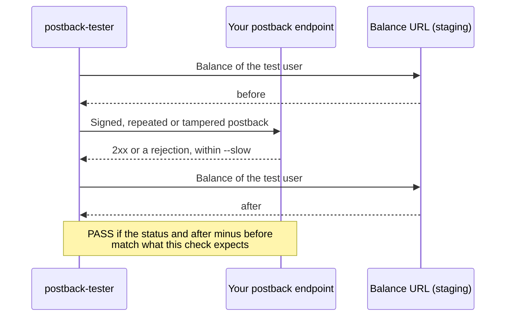

# postback-tester

**Send signed test postbacks to your reward endpoint and find out, before a network does, whether it pays twice, misses reversals or accepts forged requests.**

[](https://github.com/moonetix/postback-tester/actions/workflows/ci.yml)
[](LICENSE)
[](package.json)
[](package.json)
[](action.yml)
[](https://moonetix.com)

Maintained by [Moonetix](https://moonetix.com).

Offerwalls, survey walls and affiliate networks tell your server about a completed offer with a server-to-server postback. The handler behind that URL moves real money, and the usual way to test it is to click "send test postback" once in a dashboard and see a 200. That proves almost nothing. The bugs that cost money show up on the second request: the retry that credits again, the reversal that is ignored, the forged URL that is accepted.

`postback-tester` sends the full sequence, signs every request the way the network does, and tells you which checks your endpoint passes. It is one Node.js 22 script with no dependencies, works against any network through a template, and ships a GitHub Action for staging.

## Try it in one minute

The repo has a small server with a correct handler and a naive one. No install needed beyond Node.js 22.

```sh
git clone https://github.com/moonetix/postback-tester.git
cd postback-tester
export MOONETIX_POSTBACK_KEY=test_postback_key_not_secret

node examples/echo-server.js > echo-server.log &   # correct handler on 127.0.0.1:8080

node bin/postback-tester.js --preset moonetix \
  'http://127.0.0.1:8080/postback?user={user_id}&tx={transaction_id}&status={status}&reward={reward}&hash={hash}' \
  --balance-url 'http://127.0.0.1:8080/balance?user={user_id}' --balance-path balance
```

```text
postback-tester 1.0.0  preset moonetix  GET http://127.0.0.1:8080/postback?user={user_id}&tx={transaction_id}&status={status}&reward={reward}&hash={hash}

  PASS  Credit                                  200    11 ms  accepted, balance +100
  PASS  Duplicate credit (retry)                200     5 ms  accepted, balance unchanged
  PASS  Reversal of the credit                  200     3 ms  accepted, balance -100
  PASS  Duplicate reversal                      200     5 ms  accepted, balance unchanged
  PASS  Reversal of an unknown transaction      200     3 ms  accepted, balance unchanged
  PASS  Tampered signature                      403     5 ms  rejected, balance unchanged
  PASS  Tampered reward                         403     4 ms  rejected, balance unchanged
  PASS  Signed with the wrong secret            403     4 ms  rejected, balance unchanged
  PASS  Missing signature                       400     2 ms  rejected, balance unchanged
  PASS  Same credit in parallel                 200    12 ms  accepted, balance +100 (5 parallel requests)

10 passed, 0 failed, 0 skipped
```

Now stop it (`kill %1`), start `MODE=naive node examples/echo-server.js > echo-server.log &`, which credits every request without checking anything, and run the same command:

```text
  PASS  Credit                                  200     6 ms  accepted, balance +100
  FAIL  Duplicate credit (retry)                200     4 ms  balance changed by +100, expected 0
  ...
  FAIL  Tampered reward                         200     4 ms  accepted with 200, expected a rejection; balance changed by +1001, expected 0
  FAIL  Same credit in parallel                 200    14 ms  balance changed by +500, expected +100

2 passed, 8 failed, 0 skipped
```

The exit code is 1, so the same command fails a CI job.

## What it checks

| Check | Request | A correct endpoint |
| --- | --- | --- |
| Credit | A valid credit | Answers 2xx and adds the reward |
| Duplicate credit (retry) | The identical request again | Answers 2xx and changes nothing |
| Reversal of the credit | Reversal status, same transaction ID | Answers 2xx and takes the reward back |
| Duplicate reversal | The identical reversal again | Answers 2xx and changes nothing |
| Reversal of an unknown transaction | A reversal nobody credited | Answers 2xx and changes nothing |
| Tampered signature | One character of the signature changed | Rejects it |
| Tampered reward | Signed for one reward, sent with a larger one | Rejects it |
| Signed with the wrong secret | Valid format, wrong key | Rejects it |
| Missing signature | Signature empty or header absent | Rejects it |
| Same credit in parallel | One new credit sent 5 times at once | Answers 2xx and credits once |

"Rejects" means any answer that is not 2xx, or, with `--ok-body`, a 2xx whose body does not match. Every check fails if the answer takes longer than `--slow` (6 seconds by default, the Moonetix limit). A check that expects 2xx also fails on a redirect, since networks do not follow redirects.

From the outside, a duplicate credit and a correct one look the same: both get a 200. Point `--balance-url` at a test endpoint that returns the user's balance, and every check also verifies the balance change. That is the only way to prove the parallel check, which catches handlers that check for a duplicate and then insert in two separate steps.

## Test a Moonetix endpoint

```sh
export MOONETIX_POSTBACK_KEY=...   # Postback page of your Moonetix dashboard
npx github:moonetix/postback-tester --preset moonetix \
  'https://staging.example.com/postback?user={user_id}&tx={transaction_id}&event={event_id}&status={status}&reward={reward}&payout={payout}&hash={hash}'
```

Use the same URL you saved on the Postback page. The `moonetix` preset reproduces a Moonetix postback exactly:

- the documented macros and no others; an unknown macro such as `{foo}` stays in the URL as it is,
- values encoded like PHP `rawurlencode()`, so `!'()*` are percent-encoded too,
- rewards with at most five decimals and no trailing zeros (`150`, `0.75`, `1.00001`),
- `{hash}` = lowercase hex HMAC-SHA256 of `transaction_id:user_id:reward:status`, keyed with your postback secret key,
- status `1` and `2`, `{state}` `credited` and `reversed`, `GET`, user agent `Moonetix-Postback/1.0`, no redirects followed,
- the defaults of "Send a test postback": transaction and event IDs starting with `test_`, `offer_id` 0, `sub1` to `sub5` set to `test_sub1` to `test_sub5`.

The test suite rebuilds 132 postbacks produced by the Moonetix postback code itself, across user IDs with special characters, rounding edge cases and both statuses, and requires byte-for-byte equality ([test/moonetix.test.js](test/moonetix.test.js)). Options that would change any of this, such as `--sign` or `--method`, are refused with this preset. Set macro values with `--user`, `--reward`, `--payout` or `--set offer_id=123`.

The dashboard test is still worth running once your endpoint is public: open Offerwalls, your offerwall, Integration, and click **Send a test postback**, or use the Postback page. It goes through the real delivery path, including DNS and TLS from the Moonetix servers.

## Test any other network

`--preset custom` (the default) takes the network's URL template and signature rules from options. Macros can be written `{user_id}` or `[USER_ID]`; names are not case sensitive. Built-in values are `user_id`, `transaction_id`, `event_id`, `status`, `reward`, `payout`, `currency`, `offer_id`, `offer_name`, `country`, `ip`, `timestamp` (Unix seconds) and `secret`. The signature is available as `{signature}`, `{hash}` and `{sig}`. Anything else comes from `--set`, and `--set` values can refer to other macros, which is how you map a network's macro names.

The secret is read from `POSTBACK_SECRET`, or from the variable named with `--secret-env`. It is never accepted on the command line or in a config file, and it is replaced with `[secret]` in every report.

**MD5 of a concatenation, words for statuses, body "1" for success**

```sh
POSTBACK_SECRET=... npx github:moonetix/postback-tester \
  'https://staging.example.com/cb?uid=[USER_ID]&amount=[AMOUNT]&oid=[TX]&status=[STATUS]&sig=[SIGNATURE]' \
  --set amount={reward} --set tx={transaction_id} \
  --sign md5 --sign-input '[USER_ID][AMOUNT][TX][SECRET]' \
  --credit-status approved --reversal-status rejected \
  --ok-body '^1$'
```

**HMAC-SHA256 in the query string, negative reward on reversals**

```sh
POSTBACK_SECRET=... npx github:moonetix/postback-tester \
  'https://staging.example.com/pb?user={user_id}&tx={transaction_id}&amount={reward}&status={status}&signature={signature}' \
  --sign hmac-sha256 --sign-input '{user_id}{transaction_id}{reward}{status}' \
  --reversal-status 2 --reversal-reward negative
```

**HMAC-SHA1 of a JSON body, signature in a header**

```sh
POSTBACK_SECRET=... npx github:moonetix/postback-tester \
  'https://staging.example.com/webhooks/rewards' \
  --method POST --body-type json \
  --body '{"user":"{user_id}","tx":"{transaction_id}","status":{status},"reward":{reward}}' \
  --sign hmac-sha1 --sign-input '{body}' --sign-encoding base64 --sign-header X-Signature
```

**A static secret parameter instead of a signature**

```sh
POSTBACK_SECRET=... npx github:moonetix/postback-tester \
  'https://staging.example.com/pb?key={secret}&user={user_id}&tx={transaction_id}&reward={reward}&status={status}'
```

Here the wrong-secret and missing-signature checks send a wrong and an empty `key`; the tampered checks are skipped, because nothing protects the reward. Without any signature or secret, all four tamper checks are skipped and the report warns that anyone who knows the URL can credit rewards.

Signature options: `--sign` is `md5`, `sha1`, `sha256`, `hmac-sha1` or `hmac-sha256`; `--sign-encoding` is `hex` (default), `HEX` or `base64`. For `md5`, `sha1` and `sha256`, put `{secret}` in `--sign-input` where the network expects it. `--sign-input '{body}'` signs the exact request body.

## Balance checks

`--balance-url` is a URL template that returns the current balance of `{user_id}` on your staging system, as plain text (`150.75`) or JSON (`{"balance": 150.75}` with `--balance-path balance`, nested paths like `data.user.balance` work too). The tester reads it before and after every check and compares the change with the expected one.



Expose it on staging only, for the test user only. The tester never needs it in production, and should never run against production: it credits and reverses real balances, and the race check leaves one credit and one reversal behind for a separate transaction.

## In CI

### GitHub Action

```yaml
name: Postback
on: [deployment_status]

jobs:
  postback:
    if: github.event.deployment_status.state == 'success'
    runs-on: ubuntu-latest
    steps:
      - uses: moonetix/postback-tester@v1
        with:
          preset: moonetix
          url: https://staging.example.com/postback?user={user_id}&tx={transaction_id}&status={status}&reward={reward}&hash={hash}
          args: --balance-url https://staging.example.com/test/balance?user={user_id} --balance-path balance
          secret: ${{ secrets.STAGING_POSTBACK_KEY }}
```

Inputs: `url`, `preset`, `config` (a JSON file in the repo), `args` (more options, split like a shell would), `secret`, and `summary` (default `true`, writes the report to the job summary). The step fails when a check fails. Inputs are passed to the script through environment variables and are never interpolated into a shell command.

The CI of this repo runs the action against the example server on every push; see [.github/workflows/ci.yml](.github/workflows/ci.yml).

### Anywhere else

```sh
npx github:moonetix/postback-tester --config postback-tester.json --json > postback-report.json
```

Exit codes: `0` every check passed, `1` a check failed, `2` usage or configuration error.

## Config file

Command line options win over the file. The secret is never allowed in it.

```json
{
  "preset": "custom",
  "url": "https://staging.example.com/pb?user={user_id}&tx={transaction_id}&amount={reward}&status={status}&sig={signature}",
  "sign": { "algo": "hmac-sha256", "input": "{transaction_id}:{user_id}:{reward}:{status}", "encoding": "hex" },
  "secretEnv": "STAGING_POSTBACK_SECRET",
  "values": { "user_id": "qa_user_1", "reward": "25" },
  "statuses": { "credit": "1", "reversal": "2" },
  "balance": { "url": "https://staging.example.com/test/balance?user={user_id}", "path": "balance" },
  "skip": ["race"],
  "slowMs": 3000
}
```

Other keys: `method`, `body`, `bodyType`, `headers`, `reversalReward`, `okBody`, `checks`, `race`, `timeoutMs`. Run `node bin/postback-tester.js --help` for every option. `--dry-run` prints the signed requests without sending them, `--verbose` adds every request and answer to the report, `--json` prints a machine-readable report, and `--summary <file>` appends a Markdown table.

## Environment variables

| Variable | Read by | Default |
| --- | --- | --- |
| `MOONETIX_POSTBACK_KEY` | `--preset moonetix` (falls back to `POSTBACK_SECRET`) | none, required |
| `POSTBACK_SECRET` | `--preset custom`, when the signature or URL uses the secret | none |
| any name | `--secret-env NAME` or `"secretEnv"` in the config file, instead of the two above | none |
| `MOONETIX_APP_ID` | the `{app_id}` macro of the moonetix preset | `demoapp0000000000000001` |
| `PORT`, `HOST` | `examples/echo-server.js` | `8080`, `127.0.0.1` |
| `MODE` | `examples/echo-server.js`: `strict` or `naive` | `strict` |
| `DELAY_MS` | `examples/echo-server.js`: delay before each answer, to try `--slow` | `0` |

`.env.example` lists them with the fake test values. Load it with `set -a; . ./.env; set +a`.

## Troubleshooting

| Message | What to do |
| --- | --- |
| `No secret. Set MOONETIX_POSTBACK_KEY or POSTBACK_SECRET.` | Export the key in the same shell. Exit code 2. |
| `The moonetix preset does not allow changing sign. Use --preset custom.` | The preset is fixed to the real Moonetix format. Use `--preset custom` for other networks. |
| `Moonetix has no settable macro {foo}.` | `--set` only takes documented Moonetix macros with this preset. |
| `answered 301; redirects are not followed` | The URL redirects, usually http to https or a missing trailing slash. Use the final URL. |
| `ECONNREFUSED` or `no answer within 10000 ms` | Nothing listens on that host and port, or a firewall drops the request. |
| `balance URL did not return JSON` or `no balance found in: ...` | Add `--balance-path`, or point it at the field that holds the number. |
| `balance changed by +100, expected 0` on the duplicate checks | The handler credits retries. Store `transaction_id` under a unique key. |

## What a passing endpoint does

The checks encode the rules that keep reward balances right with any network:

1. Verify the signature first, with a constant-time comparison, before anything else runs.
2. Store each transaction ID once, enforced by a unique key in the database, not by a lookup followed by an insert.
3. On a reversal, take back what that transaction credited, once. Remember a reversal for an unknown transaction so a late credit is not paid.
4. Answer 2xx for repeats. A 4xx or 5xx makes the network retry a postback you already processed.
5. Answer only after the change is committed, and within a few seconds.

[offerwall-postback-handlers](https://github.com/moonetix/offerwall-postback-handlers) has handlers in PHP, Node.js, Python and Java that pass every check.

## Development

```sh
npm test
```

The suite covers amount formatting against PHP's rounding, `rawurlencode`, template filling, every signature algorithm against RFC test vectors, the 132 Moonetix postbacks, end-to-end runs against the example server in both modes, custom schemes (MD5 with bracket macros, HMAC over a JSON body in a header), slow answers, timeouts, redirects, refused connections, config errors and the Action's argument handling.

## Further reading

- Moonetix docs: [Postbacks](https://docs.moonetix.com/postbacks), [Credits and reversals](https://docs.moonetix.com/credits-and-reversals), [Testing and troubleshooting](https://docs.moonetix.com/testing)
- [Postback Security: Verify Every Reward Call](https://moonetix.com/academy/traffic-quality/postback-security)
- [Prevent Duplicate Reward Credits: Idempotent Postbacks](https://moonetix.com/academy/integrations/prevent-duplicate-reward-credits)
- [What Are Postback Macros? Placeholders and URL Parameters](https://moonetix.com/academy/glossary/what-are-postback-macros)
- [How to Resend a Failed Postback](https://moonetix.com/academy/integrations/resend-failed-postback)
- [Postback IP Whitelist: Should You Allowlist Sender IPs?](https://moonetix.com/academy/integrations/postback-ip-allowlist)
- Free tool: [Postback hash checker](https://moonetix.com/tools/postback-hash-checker)

## About Moonetix

[Moonetix](https://moonetix.com) is a pay-per-result affiliate network. Publishers add its offerwall to apps, games, communities and rewards sites, and users earn the publisher's own currency by completing offers. Every credit and reversal reaches the publisher as a signed postback, which is what this tool was first written to test.

**Adding an offerwall? Sign up free at https://moonetix.com/register**

Related open source: [offerwall-postback-handlers](https://github.com/moonetix/offerwall-postback-handlers), [datacenter-ip-ranges](https://github.com/moonetix/datacenter-ip-ranges), [awesome-offerwalls](https://github.com/moonetix/awesome-offerwalls), and more at [github.com/moonetix](https://github.com/moonetix).

## License

MIT. See [LICENSE](LICENSE).
